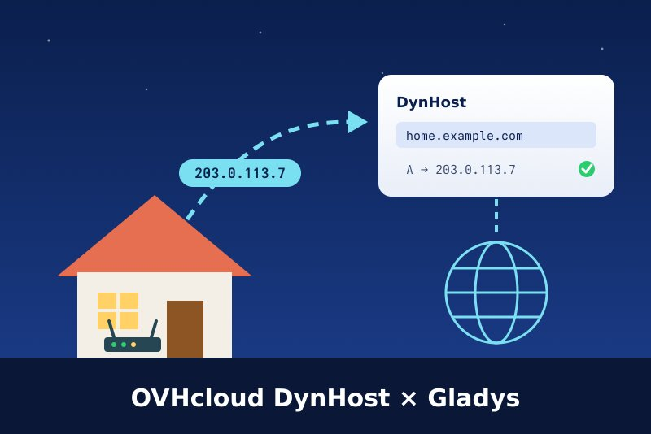
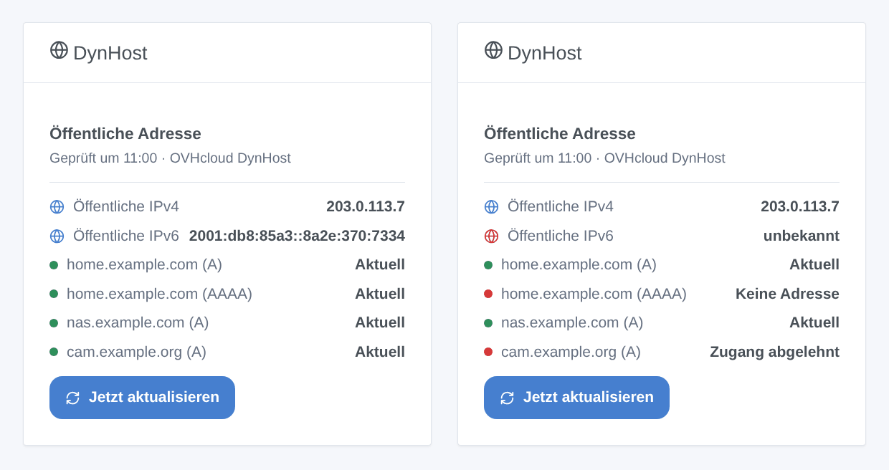
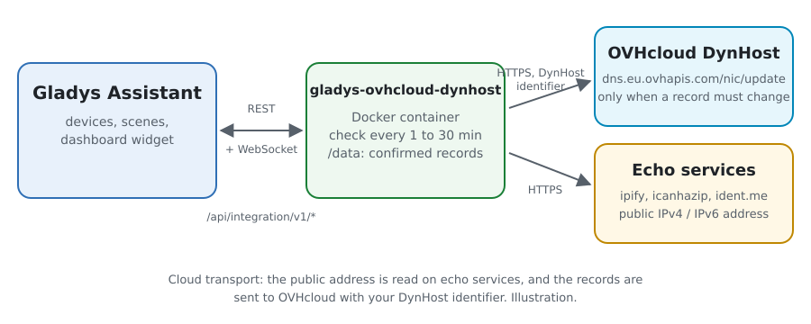
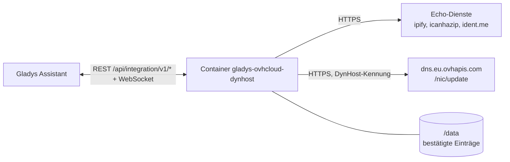
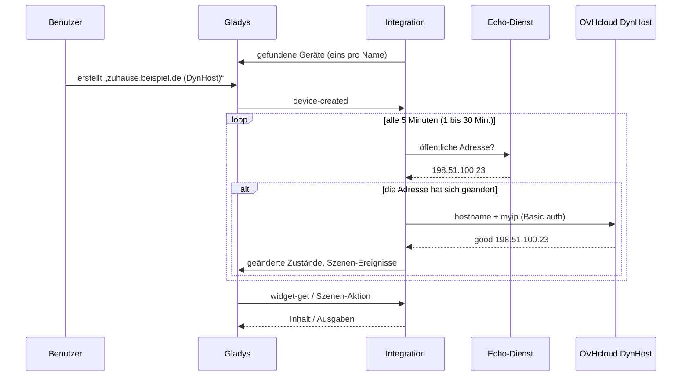

# Gladys OVHcloud DynHost

[English](README.md) · [Français](README.fr.md) · **Deutsch** · [Español](README.es.md)

[](LICENSE)
[](https://github.com/William-De71/gladys-ovhcloud-dynhost/releases)
[](https://github.com/William-De71/gladys-ovhcloud-dynhost/actions/workflows/release.yml)
[](https://gladysassistant.com)



Externe Integration für [Gladys Assistant](https://gladysassistant.com): **dynamisches DNS für eine [OVHcloud](https://www.ovhcloud.com)-Domain**. Gladys hält deine DynHost-Namen (`zuhause.beispiel.de`) über den offiziellen DynHost-Endpunkt von OVHcloud auf die öffentliche IPv4- / IPv6-Adresse deines Zuhauses gerichtet. Jeder Name wird ein Gerät, und Szenen können reagieren, wenn sich die öffentliche Adresse ändert oder eine Aktualisierung fehlschlägt.

Benutzerdokumentation: [English](docs/en.md) · [Français](docs/fr.md) · [Deutsch](docs/de.md) · [Español](docs/es.md).

> Community-Integration, nicht mit OVHcloud verbunden und nicht von OVHcloud unterstützt.

## Funktionen

- **Bis zu drei DynHost-Namen**, jeder folgt der IPv4 (A), der IPv6 (AAAA) oder beiden; der 2. und 3. Name können die Kennung des 1. verwenden (eine mit der Subdomain `*` erstellte Kennung).
- **Ein Gerät pro Name**: von OVHcloud bestätigte IPv4- und IPv6-Adressen, Status in Worten, Zahl der Adressänderungen.
- **3 Szenen-Auslöser**: öffentliche Adresse geändert, Eintrag aktualisiert, Aktualisierung fehlgeschlagen (einmal pro Fehler).
- **2 Szenen-Aktionen**: jetzt aktualisieren (ein Name oder alle, auf Wunsch erzwungen), öffentliche Adresse lesen.
- **1 Dashboard-Widget**: die öffentliche Adresse und jeder Eintrag mit seinem Status, und ein Knopf **Jetzt aktualisieren**.
- **Knöpfe der Konfiguration**: Verbindung testen (jeder Eintrag sofort gesendet), Diagnose.
- Schonend für OVHcloud: Ein Eintrag wird nur gesendet, wenn er sich ändern muss, nie zweimal in einer Minute, und eine abgelehnte Aktualisierung wird erst wieder angefragt, wenn sich Konfiguration oder Adresse ändern (oder nach 6 Stunden). Vier Sprachen (Englisch, Französisch, Deutsch, Spanisch).



## Funktionsweise





Bei jeder Prüfung (standardmäßig alle 5 Minuten) liest die Integration die öffentliche Adresse bei Echo-Diensten (der nächste, wenn einer ausfällt) und vergleicht sie mit der Adresse, die OVHcloud zuletzt für jeden Eintrag bestätigt hat, gespeichert in `/data`. Bei der allerersten Prüfung wird ein Name, der bereits auf die öffentliche Adresse auflöst, ohne Aufruf übernommen. Nur ein Eintrag, der sich ändern muss, wird an `https://dns.eu.ovhapis.com/nic/update` gesendet (`good` = geändert, `nochg` = schon aktuell); ein in der Zone von Hand geänderter Name wird eine Viertelstunde später zurückgesetzt.



### Transport

Nur Cloud (`"transports": ["cloud"]`): Der Katalog zeigt das Cloud-Abzeichen, und es gibt keinen Knopf „Lokale Verbindung bevorzugen“. Die Integration kontaktiert die Echo-Dienste `api.ipify.org`, `ipv4.icanhazip.com`, `v4.ident.me` (und ihre IPv6-Gegenstücke, wenn ein Name IPv6 folgt), die nur die Adresse deines Zuhauses sehen, und `dns.eu.ovhapis.com` mit deiner DynHost-Kennung. Die Passwörter bleiben in Gladys und im Container; der Knopf **Diagnose** zeigt nur ihre Länge.

## Geräte und Funktionen

| Gerät              | Funktion                    | Kategorie / Typ            | Bereich        |
| ------------------ | --------------------------- | -------------------------- | -------------- |
| `<Name>` (DynHost) | IPv4-Adresse (A-Eintrag)    | `text` / text              | —              |
| `<Name>` (DynHost) | IPv6-Adresse (AAAA-Eintrag) | `text` / text              | —              |
| `<Name>` (DynHost) | DynHost-Status              | `text` / text              | —              |
| `<Name>` (DynHost) | Adressänderungen            | `counter-sensor` / integer | 0 – 10 000 000 |

Externe ID: `host:<Name>`, der DynHost-Name in Kleinbuchstaben, egal in welchem Platz er eingegeben ist. Die IPv4- / IPv6-Funktionen gibt es nur, wenn der Name dieser Familie folgt. `should_poll` ist false: Die Integration prüft mit ihrem eigenen Timer.

## Szenen-Auslöser, Aktionen und Widgets

| Art      | Schlüssel           | Verwendung                                                                              |
| -------- | ------------------- | --------------------------------------------------------------------------------------- |
| Auslöser | `public_ip_changed` | Die öffentliche Adresse hat sich geändert; Filter: IPv4 / IPv6.                         |
| Auslöser | `record_updated`    | OVHcloud hat einen Namen auf eine neue Adresse gerichtet; Filter: Gerät, IPv4 / IPv6.   |
| Auslöser | `update_failed`     | Ein Eintrag konnte nicht aktualisiert werden, einmal pro Fehler; Filter: Gerät, Fehler. |
| Aktion   | `update_now`        | Jetzt prüfen und aktualisieren; ein Name oder alle, auf Wunsch erzwungen.               |
| Aktion   | `get_public_ip`     | Die öffentliche IPv4 und IPv6, und ein Satz.                                            |
| Widget   | `status`            | Öffentliche Adresse, jeder Eintrag mit seinem Status, **Jetzt aktualisieren**.          |

Die Variablen der Auslöser liefern den Namen, den Adresstyp, die neue und die vorherige Adresse, und bei einem Fehler den Fehlercode und die Meldung. Die erste Prüfung ist die Ausgangsbasis: Die bei der Installation gesehene öffentliche Adresse löst nichts aus, und ein Neustart löst dieselbe Änderung nie zweimal aus. Eine Szenen-Aktion löst nie einen Auslöser aus (keine Schleifen); eine von ihr gesehene Änderung löst trotzdem bei der nächsten Prüfung aus.

Beispiele:

- „Öffentliche Adresse geändert“ → „Neue Adresse: {{triggerEvent.data.ip}}“ an dein Telefon senden.
- „Aktualisierung fehlgeschlagen“, Fehler „Kennung abgelehnt“ → dich daran erinnern, das DynHost-Passwort zu prüfen.
- Jeden Morgen → „öffentliche Adresse lesen“ → in eine Nachricht schreiben.

## Voraussetzungen

- Gladys Assistant **5.3.0** oder neuer (Widgets, Szenen-Auslöser und -Aktionen externer Integrationen, Katalog-Schlüsselwörter von Gladys 5.3). Ältere Instanzen können die Integration nicht installieren.
- Eine Domain bei OVHcloud, deren DNS-Zone von OVHcloud verwaltet wird, eine **DynHost-Kennung** (Kundencenter → Domain → DynHost → Zugänge verwalten) und ein **DynHost-Eintrag** pro Name (und ein zweiter vom Typ AAAA für IPv6).

## Installation

- **Aus dem Store** von Gladys (Integrationen → Externe Integrationen), mit einem Klick, sobald indexiert.
- **Über die URL des Repositorys**: `https://github.com/William-De71/gladys-ovhcloud-dynhost`.
- **Entwicklermodus**: Baue das Image lokal (`docker build -t gladys-ovhcloud-dynhost .`) und installiere es aus Gladys.

## Konfiguration

| Feld                              | Beschreibung                                                                         |
| --------------------------------- | ------------------------------------------------------------------------------------ |
| DynHost-Name (× 3)                | `zuhause.beispiel.de`, oder `beispiel.de` für die Domain selbst. Der 1. ist Pflicht. |
| DynHost-Kennung (× 3)             | `beispiel.de-zuhause`. Leer für den 2. und 3. Namen: die Kennung des 1.              |
| Passwort (× 3)                    | Das Passwort der Kennung (geheim).                                                   |
| Zu aktualisierende Einträge (× 3) | IPv4 (A, Standard), IPv6 (AAAA) oder beide.                                          |
| Prüfung der öffentlichen Adresse  | Jede Minute, alle 5 Minuten (Standard), 15 oder 30 Minuten.                          |
| Sprache der Texte                 | Gerätenamen, Status und Szenen-Zusammenfassungen. Automatisch folgt dem Dashboard.   |

Knöpfe: **Verbindung testen** (sendet jeden Eintrag sofort an OVHcloud und zeigt die Antwort pro Name) und **Diagnose** (schreibt die Konfiguration, die öffentlichen Adressen, die bestätigten Einträge und die letzten Fehler in den Tab Protokolle, Passwörter verborgen).

## Verwendung

1. Erstelle im OVHcloud-Kundencenter eine DynHost-Kennung und einen DynHost-Eintrag, gib Name, Kennung und Passwort ein, speichere und drücke **Verbindung testen**.
2. Erstelle im Tab **Geräteerkennung** das Gerät jedes Namens.
3. Füge das Widget **DynHost** einem Dashboard hinzu, und baue Szenen mit den Auslösern und Aktionen oben.

## Entwicklung

```bash
npm install
npm test                       # node --test, nie mit dem Netzwerk
npm run lint && npm run format:check
npx github:GladysAssistant/integration-store . --skip-image-check
scripts/build-cover.sh         # cover.jpg aus docs/assets/cover.svg
docs/illustrations/render.sh   # docs/assets/widgets.<lang>.png
node .github/scripts/release.mjs next
```

Lokal liest das SDK `GLADYS_HOST_API_URL`, `GLADYS_INTEGRATION_TOKEN` und `GLADYS_INTEGRATION_SELECTOR`; `DEBUG=gladys-integration-sdk` zeigt die Protokolle des SDK und prüft jeden Widget-Inhalt. Die Tests nutzen ein falsches Netzwerk, das wie OVHcloud antwortet (`good`, `nochg`, dyndns2-Codes, HTTP 401), und einen falschen Resolver. Die Regeln des Projekts stehen in [CLAUDE.md](CLAUDE.md).

## Release-Prozess


Jeder Merge auf `main` startet die CI und berechnet dann die Version aus den [Conventional Commits](https://www.conventionalcommits.org/) seit dem letzten Tag: `feat` → Minor, `fix` / `perf` → Patch, `!` oder `BREAKING CHANGE` → Major (ein Minor vor 1.0.0); `docs`, `chore`, `ci`, `test`, `style`, `refactor`, `build` allein veröffentlichen nichts. Der Changelog-Abschnitt wird erzeugt, der Tag gepusht, das Multi-Architektur-Image gebaut, dann erhält `main` den Release-Commit, die GitHub Release wird erstellt und ein letzter Job prüft das öffentliche Image, den Store-Validator und das Topic.

- Der Titel des Pull Requests wird zum Squash-Commit und dann zur Changelog-Zeile: Schreibe ihn auf Englisch, für den Benutzer (`pr-title.yml` prüft ihn). Bearbeite `CHANGELOG.md` nie von Hand.
- 1.0.0 ist eine Entscheidung: Actions → Release → Run workflow mit `release-as: 1.0.0`. `dry-run` zeigt Version und Notizen, ohne etwas zu veröffentlichen.
- **Geschützter Branch**: Das Release pusht seinen Commit mit `GITHUB_TOKEN` auf `main`. Mit einem Ruleset auf `main`, das strenger ist als „kein Löschen, kein Force-Push“, füge GitHub Actions zu seiner Ausnahmeliste hinzu (oder pushe über eine GitHub App), sonst schlägt der Veröffentlichungsjob mit Anweisungen fehl.
- Mache nach dem ersten Release das `ghcr.io`-Paket öffentlich (Package settings → Change visibility), sonst kann Gladys es nicht herunterladen.

## Fehlerbehebung

Siehe [docs/de.md](docs/de.md#fehlerbehebung). Melde Probleme mit den Versionen von Gladys und der Integration, dem betroffenen Namen und Adresstyp und den Zeilen des Knopfs **Diagnose**, nie mit einem Passwort.

## Mitwirken

Issues und Pull Requests sind willkommen. Führe vor einem Pull Request `npm run format:check && npm run lint && npm test` aus, und lass alle externen IDs und gespeicherten Schlüssel unverändert (siehe [CLAUDE.md](CLAUDE.md)).

## Sicherheit

Siehe [SECURITY.md](SECURITY.md): Melde Schwachstellen vertraulich. Die Passwörter sind `secret`-Felder: nie protokolliert, nie anderswohin als an `dns.eu.ovhapis.com` gesendet, nie in `/data` geschrieben. Die Integration läuft schreibgeschützt, als Benutzer ohne Root-Rechte, in ihrem Container.

## Kommende Screenshots

Die Bilder oben sind Illustrationen, keine Screenshots. Echte Screenshots kommen nach `docs/assets/screenshots/` (PNG, 1280 × 800): `configuration.png`, `discovery.png`, `device.png`, `scene.png`.

## Lizenz

[Apache-Lizenz 2.0](LICENSE), siehe auch [NOTICE](NOTICE). Die Einträge werden über den [DynHost-Endpunkt von OVHcloud](https://docs.ovhcloud.com/fr/guides/web-cloud/domains/dns-dynhost) aktualisiert; die öffentliche Adresse wird bei [ipify](https://www.ipify.org), [icanhazip](https://icanhazip.com) und [ident.me](https://ident.me) gelesen. OVHcloud und DynHost sind Marken der OVH SAS. Danke an die Dokumentation und das SDK von Gladys.
