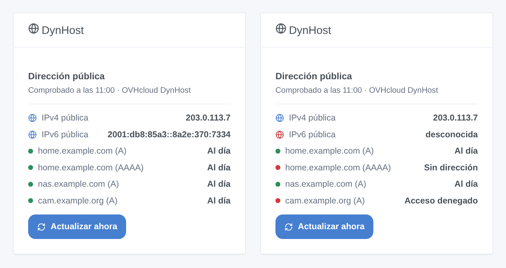
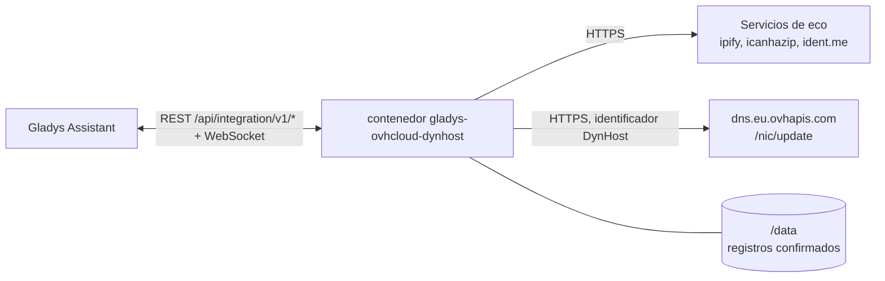
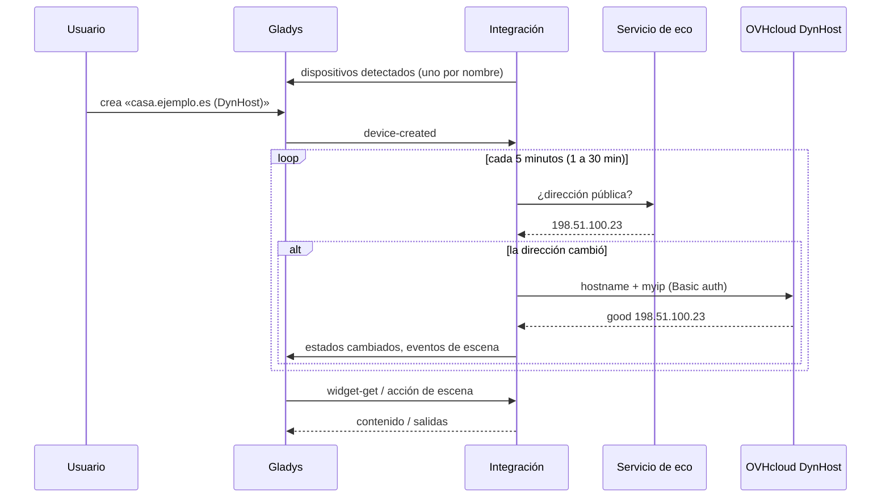

# Gladys OVHcloud DynHost

[English](README.md) · [Français](README.fr.md) · [Deutsch](README.de.md) · **Español**

[](LICENSE)
[](https://github.com/William-De71/gladys-ovhcloud-dynhost/releases)
[](https://github.com/William-De71/gladys-ovhcloud-dynhost/actions/workflows/release.yml)
[](https://gladysassistant.com)


Integración externa de [Gladys Assistant](https://gladysassistant.com) de **DNS dinámico para un dominio [OVHcloud](https://www.ovhcloud.com)**: Gladys mantiene tus nombres DynHost (`casa.ejemplo.es`) apuntando a la dirección pública IPv4 / IPv6 de tu casa, mediante el punto de acceso oficial DynHost de OVHcloud. Cada nombre se convierte en un dispositivo, y las escenas pueden reaccionar cuando cambia la dirección pública o falla una actualización.

Documentación de usuario: [English](docs/en.md) · [Français](docs/fr.md) · [Deutsch](docs/de.md) · [Español](docs/es.md).

> Integración comunitaria, sin relación con OVHcloud ni respaldada por OVHcloud.

## Funciones

- **Hasta tres nombres DynHost**, cada uno siguiendo la IPv4 (A), la IPv6 (AAAA) o ambas; el 2.º y el 3.er nombre pueden usar el identificador del 1.º (un identificador creado con el subdominio `*`).
- **Un dispositivo por nombre**: direcciones IPv4 e IPv6 confirmadas por OVHcloud, estado en palabras, número de cambios de dirección.
- **3 disparadores de escena**: dirección pública cambiada, registro actualizado, fallo de actualización (una vez por error).
- **2 acciones de escena**: actualizar ahora (un nombre o todos, opcionalmente forzado), leer la dirección pública.
- **1 widget del panel**: la dirección pública y cada registro con su estado, y un botón **Actualizar ahora**.
- **Botones de configuración**: probar la conexión (cada registro enviado al instante), diagnóstico.
- Respetuosa con OVHcloud: un registro solo se envía cuando debe cambiar, nunca dos veces en un minuto, y una actualización rechazada no se vuelve a pedir hasta que cambien la configuración o la dirección (o 6 horas). Cuatro idiomas (inglés, francés, alemán, español).



## Funcionamiento




En cada comprobación (cada 5 minutos por defecto), la integración lee la dirección pública en servicios de eco (el siguiente si uno falla) y la compara con la dirección que OVHcloud confirmó por última vez para cada registro, guardada en `/data`. En la primerísima comprobación, un nombre que ya resuelve a la dirección pública se adopta sin llamada. Solo se envía a `https://dns.eu.ovhapis.com/nic/update` un registro que debe cambiar (`good` = cambiado, `nochg` = ya al día); un nombre cambiado a mano en la zona se restablece un cuarto de hora después.



### Transporte

Solo cloud (`"transports": ["cloud"]`): el catálogo muestra la insignia cloud, y no hay botón «Preferir la conexión local». La integración contacta con los servicios de eco `api.ipify.org`, `ipv4.icanhazip.com`, `v4.ident.me` (y sus equivalentes IPv6 cuando un nombre sigue la IPv6), que solo ven la dirección de tu casa, y con `dns.eu.ovhapis.com` con tu identificador DynHost. Las contraseñas se quedan en Gladys y en el contenedor; el botón **Diagnóstico** solo muestra su longitud.

## Dispositivos y funciones

| Dispositivo          | Función                        | Categoría / tipo           | Rango          |
| -------------------- | ------------------------------ | -------------------------- | -------------- |
| `<nombre>` (DynHost) | Dirección IPv4 (registro A)    | `text` / text              | —              |
| `<nombre>` (DynHost) | Dirección IPv6 (registro AAAA) | `text` / text              | —              |
| `<nombre>` (DynHost) | Estado del DynHost             | `text` / text              | —              |
| `<nombre>` (DynHost) | Cambios de dirección           | `counter-sensor` / integer | 0 – 10 000 000 |

Identificador externo: `host:<nombre>`, el nombre DynHost en minúsculas, sea cual sea la posición en que se escribe. Las funciones IPv4 / IPv6 solo existen si el nombre sigue esa familia. `should_poll` vale false: la integración comprueba con su propio temporizador.

## Disparadores, acciones de escena y widgets

| Tipo       | Clave               | Uso                                                                                 |
| ---------- | ------------------- | ----------------------------------------------------------------------------------- |
| Disparador | `public_ip_changed` | La dirección pública cambió; filtro: IPv4 / IPv6.                                   |
| Disparador | `record_updated`    | OVHcloud apuntó un nombre a una nueva dirección; filtros: dispositivo, IPv4 / IPv6. |
| Disparador | `update_failed`     | Un registro no se pudo actualizar, una vez por error; filtros: dispositivo, error.  |
| Acción     | `update_now`        | Comprobar y actualizar ahora; un nombre o todos, opcionalmente forzado.             |
| Acción     | `get_public_ip`     | La IPv4 y la IPv6 públicas, y una frase.                                            |
| Widget     | `status`            | Dirección pública, cada registro con su estado, **Actualizar ahora**.               |

Las variables de los disparadores dan el nombre, el tipo de dirección, la dirección nueva y la anterior, y en un fallo el código y el mensaje de error. La primera comprobación sirve de referencia: la dirección pública vista al instalar no dispara nada, y un reinicio nunca dispara dos veces el mismo cambio. Una acción de escena nunca lanza un disparador (sin bucles); un cambio que haya visto dispara igualmente en la siguiente comprobación.

Ejemplos:

- «Dirección pública cambiada» → enviar «Nueva dirección: {{triggerEvent.data.ip}}» a tu teléfono.
- «Fallo de actualización», error «identificador rechazado» → recordarte revisar la contraseña DynHost.
- Cada mañana → «leer la dirección pública» → escribirla en un mensaje.

## Requisitos

- Gladys Assistant **5.3.0** o posterior (widgets, disparadores y acciones de escena de las integraciones externas, palabras clave del catálogo de Gladys 5.3). Las instancias más antiguas no pueden instalar la integración.
- Un dominio en OVHcloud cuya zona DNS gestione OVHcloud, un **identificador DynHost** (área de cliente → dominio → DynHost → Gestionar los accesos) y un **registro DynHost** por nombre (y un segundo de tipo AAAA para IPv6).

## Instalación

- **Desde la tienda** de Gladys (Integraciones → Integraciones externas), con un clic, una vez indexada.
- **Desde la URL del repositorio**: `https://github.com/William-De71/gladys-ovhcloud-dynhost`.
- **Modo desarrollador**: construye la imagen en local (`docker build -t gladys-ovhcloud-dynhost .`) e instálala desde Gladys.

## Configuración

| Campo                                | Descripción                                                                       |
| ------------------------------------ | --------------------------------------------------------------------------------- |
| Nombre DynHost (× 3)                 | `casa.ejemplo.es`, o `ejemplo.es` para el propio dominio. El 1.º es obligatorio.  |
| Identificador DynHost (× 3)          | `ejemplo.es-casa`. Vacío para el 2.º y 3.er nombre: el identificador del 1.º.     |
| Contraseña (× 3)                     | La contraseña del identificador (secreta).                                        |
| Registros que actualizar (× 3)       | IPv4 (A, por defecto), IPv6 (AAAA) o ambos.                                       |
| Comprobación de la dirección pública | Cada minuto, cada 5 minutos (por defecto), 15 o 30 minutos.                       |
| Idioma de los textos                 | Nombres de dispositivos, estado y resúmenes de escena. Automático sigue el panel. |

Botones: **Probar la conexión** (envía al instante cada registro a OVHcloud y muestra la respuesta nombre por nombre) y **Diagnóstico** (escribe la configuración, las direcciones públicas, los registros confirmados y los últimos errores en la pestaña Registros, con las contraseñas ocultas).

## Uso

1. Crea un identificador DynHost y un registro DynHost en el área de cliente de OVHcloud, introduce el nombre, el identificador y su contraseña, guarda y pulsa **Probar la conexión**.
2. En la pestaña **Detección**, crea el dispositivo de cada nombre.
3. Añade el widget **DynHost** a un panel, y crea escenas con los disparadores y acciones anteriores.

## Desarrollo

```bash
npm install
npm test                       # node --test, nunca toca la red
npm run lint && npm run format:check
npx github:GladysAssistant/integration-store . --skip-image-check
scripts/build-cover.sh         # cover.jpg desde docs/assets/cover.svg
docs/illustrations/render.sh   # docs/assets/widgets.<lang>.png
node .github/scripts/release.mjs next
```

En local, el SDK lee `GLADYS_HOST_API_URL`, `GLADYS_INTEGRATION_TOKEN` y `GLADYS_INTEGRATION_SELECTOR`; `DEBUG=gladys-integration-sdk` muestra los registros del SDK y comprueba cada contenido de widget. Las pruebas usan una red falsa que responde como OVHcloud (`good`, `nochg`, códigos dyndns2, HTTP 401) y un resolvedor falso. Las reglas del proyecto están en [CLAUDE.md](CLAUDE.md).

## Proceso de publicación


Cada fusión en `main` lanza la CI y luego calcula la versión a partir de los [Conventional Commits](https://www.conventionalcommits.org/) desde la última etiqueta: `feat` → menor, `fix` / `perf` → parche, `!` o `BREAKING CHANGE` → mayor (una menor antes de 1.0.0); `docs`, `chore`, `ci`, `test`, `style`, `refactor`, `build` solos no publican nada. Se genera la sección del changelog, se sube la etiqueta, se construye la imagen multiarquitectura, luego `main` recibe el commit de publicación, se crea la GitHub Release y un último job comprueba la imagen pública, el validador de la tienda y el topic.

- El título de la pull request se convierte en el commit squash y luego en la línea del changelog: escríbelo en inglés, para el usuario (`pr-title.yml` lo comprueba). Nunca edites `CHANGELOG.md` a mano.
- La 1.0.0 es una decisión: Actions → Release → Run workflow con `release-as: 1.0.0`. `dry-run` muestra la versión y las notas sin publicar nada.
- **Rama protegida**: la publicación sube su commit a `main` con `GITHUB_TOKEN`. Con un ruleset en `main` más estricto que «sin borrado, sin force-push», añade GitHub Actions a su lista de excepciones (o sube mediante una GitHub App); si no, el job de publicación falla con instrucciones.
- Tras la primera publicación, haz público el paquete `ghcr.io` (Package settings → Change visibility); si no, Gladys no puede descargarlo.

## Solución de problemas

Consulta [docs/es.md](docs/es.md#solución-de-problemas). Informa de los problemas con las versiones de Gladys y de la integración, el nombre y el tipo de dirección afectados, y las líneas del botón **Diagnóstico**, nunca una contraseña.

## Contribuir

Las issues y pull requests son bienvenidas. Ejecuta `npm run format:check && npm run lint && npm test` antes de abrir una pull request, y mantén sin cambios todos los identificadores externos y claves guardadas (ver [CLAUDE.md](CLAUDE.md)).

## Seguridad

Ver [SECURITY.md](SECURITY.md): informa de las vulnerabilidades en privado. Las contraseñas son campos `secret`: nunca se registran, nunca se envían a otro sitio que `dns.eu.ovhapis.com`, nunca se escriben en `/data`. La integración se ejecuta en solo lectura, como usuario sin privilegios, en su contenedor.

## Capturas por venir

Las imágenes anteriores son ilustraciones, no capturas de pantalla. Las capturas reales irán en `docs/assets/screenshots/` (PNG, 1280 × 800): `configuration.png`, `discovery.png`, `device.png`, `scene.png`.

## Licencia

[Licencia Apache 2.0](LICENSE), ver también [NOTICE](NOTICE). Los registros se actualizan mediante el [punto de acceso DynHost de OVHcloud](https://docs.ovhcloud.com/fr/guides/web-cloud/domains/dns-dynhost); la dirección pública se lee en [ipify](https://www.ipify.org), [icanhazip](https://icanhazip.com) e [ident.me](https://ident.me). OVHcloud y DynHost son marcas de OVH SAS. Gracias a la documentación y al SDK de Gladys.
