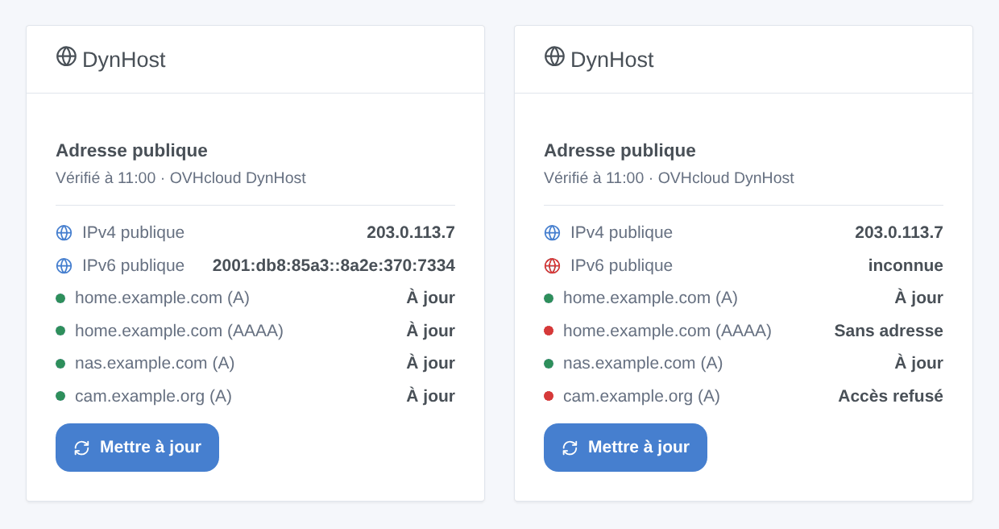
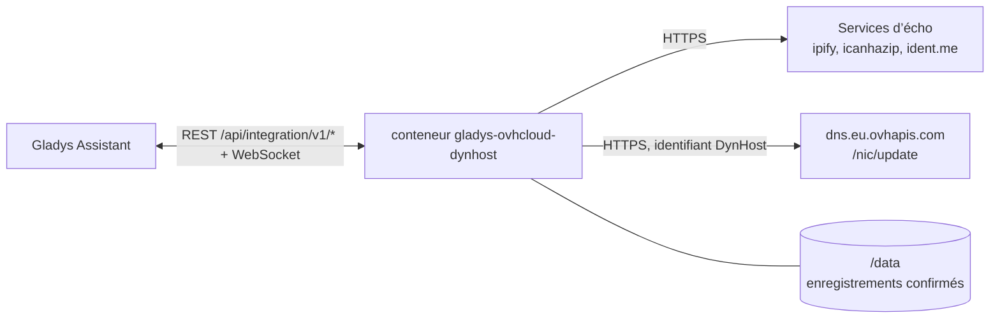
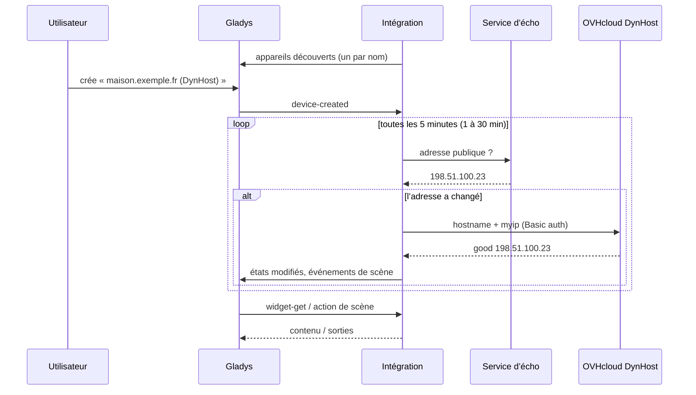

# Gladys OVHcloud DynHost

[English](README.md) · **Français** · [Deutsch](README.de.md) · [Español](README.es.md)

[](LICENSE)
[](https://github.com/William-De71/gladys-ovhcloud-dynhost/releases)
[](https://github.com/William-De71/gladys-ovhcloud-dynhost/actions/workflows/release.yml)
[](https://gladysassistant.com)


Intégration externe [Gladys Assistant](https://gladysassistant.com) de **DNS dynamique pour un domaine [OVHcloud](https://www.ovhcloud.com)** : Gladys garde vos noms DynHost (`maison.exemple.fr`) pointés vers l’adresse publique IPv4 / IPv6 de votre maison, par le point d’accès officiel DynHost d’OVHcloud. Chaque nom devient un appareil, et des scènes peuvent réagir quand l’adresse publique change ou qu’une mise à jour échoue.

Documentation utilisateur : [English](docs/en.md) · [Français](docs/fr.md) · [Deutsch](docs/de.md) · [Español](docs/es.md).

> Intégration communautaire, sans lien avec OVHcloud ni approuvée par OVHcloud.

## Fonctionnalités

- **Jusqu’à trois noms DynHost**, chacun suivant l’IPv4 (A), l’IPv6 (AAAA) ou les deux ; le 2e et le 3e nom peuvent reprendre l’identifiant du 1er (un identifiant créé avec le sous-domaine `*`).
- **Un appareil par nom** : adresses IPv4 et IPv6 confirmées par OVHcloud, état en clair, nombre de changements d’adresse.
- **3 déclencheurs de scène** : adresse publique changée, enregistrement mis à jour, échec de mise à jour (une fois par erreur).
- **2 actions de scène** : mettre à jour (un nom ou tous, éventuellement forcé), lire l’adresse publique.
- **1 widget de tableau de bord** : l’adresse publique et chaque enregistrement avec son état, et un bouton **Mettre à jour**.
- **Boutons de configuration** : tester la connexion (chaque enregistrement envoyé tout de suite), diagnostic.
- Respectueuse d’OVHcloud : un enregistrement n’est envoyé que s’il doit changer, jamais deux fois en une minute, et une mise à jour refusée n’est pas redemandée avant que la configuration ou l’adresse change (ou 6 heures). Quatre langues (anglais, français, allemand, espagnol).



## Fonctionnement




À chaque vérification (toutes les 5 minutes par défaut), l’intégration lit l’adresse publique sur des services d’écho (le suivant si l’un échoue) et la compare à l’adresse qu’OVHcloud a confirmée en dernier pour chaque enregistrement, gardée dans `/data`. À la toute première vérification, un nom qui résout déjà vers l’adresse publique est adopté sans appel. Seul un enregistrement qui doit changer est envoyé à `https://dns.eu.ovhapis.com/nic/update` (`good` = changé, `nochg` = déjà à jour) ; un nom modifié à la main dans la zone est remis en place un quart d’heure plus tard.



### Transport

Cloud uniquement (`"transports": ["cloud"]`) : le catalogue affiche le badge cloud, et il n’y a pas de bouton « Préférer la connexion locale ». L’intégration contacte les services d’écho `api.ipify.org`, `ipv4.icanhazip.com`, `v4.ident.me` (et leurs équivalents IPv6 quand un nom suit l’IPv6), qui ne voient que l’adresse de votre maison, et `dns.eu.ovhapis.com` avec votre identifiant DynHost. Les mots de passe restent dans Gladys et dans le conteneur ; le bouton **Diagnostic** n’affiche que leur longueur.

## Appareils et fonctionnalités

| Appareil          | Fonctionnalité                     | Catégorie / type           | Plage          |
| ----------------- | ---------------------------------- | -------------------------- | -------------- |
| `<nom>` (DynHost) | Adresse IPv4 (enregistrement A)    | `text` / text              | —              |
| `<nom>` (DynHost) | Adresse IPv6 (enregistrement AAAA) | `text` / text              | —              |
| `<nom>` (DynHost) | État du DynHost                    | `text` / text              | —              |
| `<nom>` (DynHost) | Changements d’adresse              | `counter-sensor` / integer | 0 – 10 000 000 |

Identifiant externe : `host:<nom>`, le nom DynHost en minuscules, quel que soit l’emplacement où il est saisi. Les fonctionnalités IPv4 / IPv6 n’existent que si le nom suit cette famille. `should_poll` vaut false : l’intégration vérifie avec son propre minuteur.

## Déclencheurs, actions de scène et widgets

| Type        | Clé                 | Usage                                                                                           |
| ----------- | ------------------- | ----------------------------------------------------------------------------------------------- |
| Déclencheur | `public_ip_changed` | L’adresse publique a changé ; filtre : IPv4 / IPv6.                                             |
| Déclencheur | `record_updated`    | OVHcloud a pointé un nom vers une nouvelle adresse ; filtres : appareil, IPv4 / IPv6.           |
| Déclencheur | `update_failed`     | Un enregistrement n’a pas pu être mis à jour, une fois par erreur ; filtres : appareil, erreur. |
| Action      | `update_now`        | Vérifier et mettre à jour tout de suite ; un nom ou tous, éventuellement forcé.                 |
| Action      | `get_public_ip`     | L’IPv4 et l’IPv6 publiques, et une phrase.                                                      |
| Widget      | `status`            | Adresse publique, chaque enregistrement avec son état, **Mettre à jour**.                       |

Les variables des déclencheurs donnent le nom, le type d’adresse, la nouvelle et l’ancienne adresse, et pour un échec le code et le message d’erreur. La première vérification sert de référence : l’adresse publique vue à l’installation ne déclenche rien, et un redémarrage ne déclenche jamais deux fois le même changement. Une action de scène ne lance jamais de déclencheur (pas de boucle) ; un changement qu’elle a vu déclenche quand même à la vérification suivante.

Exemples :

- « Adresse publique changée » → envoyer « Nouvelle adresse : {{triggerEvent.data.ip}} » sur votre téléphone.
- « Échec de mise à jour », erreur « identifiant refusé » → vous rappeler de vérifier le mot de passe DynHost.
- Chaque matin → « lire l’adresse publique » → l’écrire dans un message.

## Prérequis

- Gladys Assistant **5.3.0** ou plus récent (widgets, déclencheurs et actions de scène des intégrations externes, mots-clés du catalogue de Gladys 5.3). Les instances plus anciennes ne peuvent pas installer l’intégration.
- Un domaine chez OVHcloud dont la zone DNS est gérée par OVHcloud, un **identifiant DynHost** (espace client → domaine → DynHost → Gérer les accès) et un **DynHost** par nom (et un second de type AAAA pour l’IPv6).

## Installation

- **Depuis le store** de Gladys (Intégrations → Intégrations externes), en un clic, une fois indexée.
- **Depuis l’URL du dépôt** : `https://github.com/William-De71/gladys-ovhcloud-dynhost`.
- **Mode développeur** : construisez l’image localement (`docker build -t gladys-ovhcloud-dynhost .`) et installez-la depuis Gladys.

## Configuration

| Champ                                 | Description                                                                            |
| ------------------------------------- | -------------------------------------------------------------------------------------- |
| Nom DynHost (× 3)                     | `maison.exemple.fr`, ou `exemple.fr` pour le domaine lui-même. Le 1er est obligatoire. |
| Identifiant DynHost (× 3)             | `exemple.fr-maison`. Vide pour le 2e et le 3e nom : l’identifiant du 1er.              |
| Mot de passe (× 3)                    | Le mot de passe de l’identifiant (secret).                                             |
| Enregistrements à mettre à jour (× 3) | IPv4 (A, par défaut), IPv6 (AAAA), ou les deux.                                        |
| Vérification de l’adresse publique    | Toutes les minutes, 5 minutes (par défaut), 15 ou 30 minutes.                          |
| Langue des textes                     | Noms d’appareils, état et résumés de scène. Automatique suit le tableau de bord.       |

Boutons : **Tester la connexion** (envoie tout de suite chaque enregistrement à OVHcloud et affiche la réponse nom par nom) et **Diagnostic** (écrit la configuration, les adresses publiques, les enregistrements confirmés et les dernières erreurs dans l’onglet Journaux, mots de passe masqués).

## Utilisation

1. Créez un identifiant DynHost et un DynHost dans l’espace client OVHcloud, saisissez le nom, l’identifiant et son mot de passe, enregistrez et appuyez sur **Tester la connexion**.
2. Dans l’onglet **Découverte**, créez l’appareil de chaque nom.
3. Ajoutez le widget **DynHost** à un tableau de bord, et construisez des scènes avec les déclencheurs et actions ci-dessus.

## Développement

```bash
npm install
npm test                       # node --test, ne touche jamais au réseau
npm run lint && npm run format:check
npx github:GladysAssistant/integration-store . --skip-image-check
scripts/build-cover.sh         # cover.jpg depuis docs/assets/cover.svg
docs/illustrations/render.sh   # docs/assets/widgets.<lang>.png
node .github/scripts/release.mjs next
```

En local, le SDK lit `GLADYS_HOST_API_URL`, `GLADYS_INTEGRATION_TOKEN` et `GLADYS_INTEGRATION_SELECTOR` ; `DEBUG=gladys-integration-sdk` affiche les journaux du SDK et vérifie chaque contenu de widget. Les tests utilisent un faux réseau qui répond comme OVHcloud (`good`, `nochg`, codes dyndns2, HTTP 401) et un faux résolveur. Les règles du projet sont dans [CLAUDE.md](CLAUDE.md).

## Processus de release


Chaque fusion sur `main` lance la CI, puis calcule la version à partir des [Conventional Commits](https://www.conventionalcommits.org/) depuis le dernier tag : `feat` → mineure, `fix` / `perf` → correctif, `!` ou `BREAKING CHANGE` → majeure (une mineure avant 1.0.0) ; `docs`, `chore`, `ci`, `test`, `style`, `refactor`, `build` seuls ne publient rien. La section du changelog est générée, le tag poussé, l’image multi-architecture construite, puis `main` reçoit le commit de release, la GitHub Release est créée et un dernier job vérifie l’image publique, le validateur du store et le topic.

- Le titre de la pull request devient le commit squash, puis la ligne du changelog : écrivez-le en anglais, pour l’utilisateur (`pr-title.yml` le vérifie). Ne modifiez jamais `CHANGELOG.md` à la main.
- La 1.0.0 est une décision : Actions → Release → Run workflow avec `release-as: 1.0.0`. `dry-run` affiche la version et les notes sans rien publier.
- **Branche protégée** : la release pousse son commit sur `main` avec `GITHUB_TOKEN`. Avec un ruleset sur `main` plus strict que « ni suppression ni force-push », ajoutez GitHub Actions à sa liste de contournement (ou poussez via une GitHub App), sinon le job de publication échoue avec des instructions.
- Après la première release, rendez public le package `ghcr.io` (Package settings → Change visibility), sinon Gladys ne peut pas le télécharger.

## Dépannage

Voir [docs/fr.md](docs/fr.md#dépannage). Signalez un problème avec les versions de Gladys et de l’intégration, le nom et le type d’adresse concernés, et les lignes du bouton **Diagnostic**, jamais un mot de passe.

## Contribuer

Issues et pull requests bienvenues. Lancez `npm run format:check && npm run lint && npm test` avant d’ouvrir une pull request, et gardez inchangés tous les identifiants externes et clés enregistrées (voir [CLAUDE.md](CLAUDE.md)).

## Sécurité

Voir [SECURITY.md](SECURITY.md) : signalez les vulnérabilités en privé. Les mots de passe sont des champs `secret` : jamais écrits dans les journaux, jamais envoyés ailleurs qu’à `dns.eu.ovhapis.com`, jamais écrits dans `/data`. L’intégration tourne en lecture seule, avec un utilisateur non root, dans son conteneur.

## Captures à venir

Les images ci-dessus sont des illustrations, pas des captures d’écran. Les vraies captures iront dans `docs/assets/screenshots/` (PNG, 1280 × 800) : `configuration.png`, `discovery.png`, `device.png`, `scene.png`.

## Licence

[Licence Apache 2.0](LICENSE), voir aussi [NOTICE](NOTICE). Les enregistrements sont mis à jour par le [point d’accès DynHost d’OVHcloud](https://docs.ovhcloud.com/fr/guides/web-cloud/domains/dns-dynhost) ; l’adresse publique est lue sur [ipify](https://www.ipify.org), [icanhazip](https://icanhazip.com) et [ident.me](https://ident.me). OVHcloud et DynHost sont des marques d’OVH SAS. Merci à la documentation et au SDK de Gladys.
