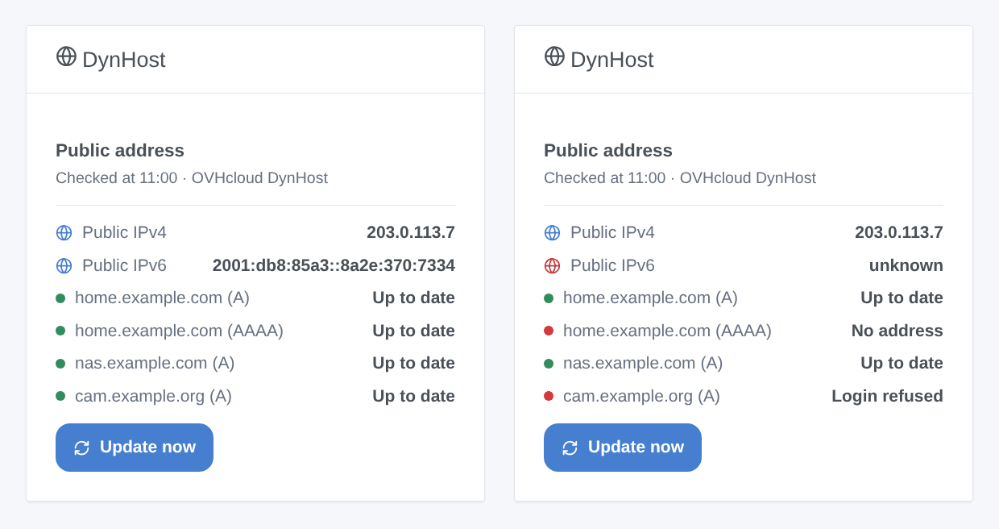
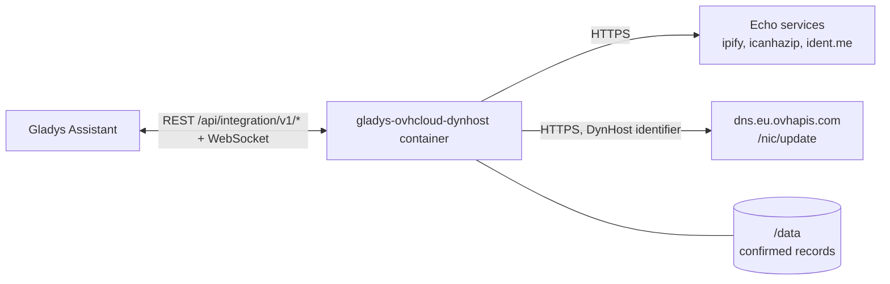
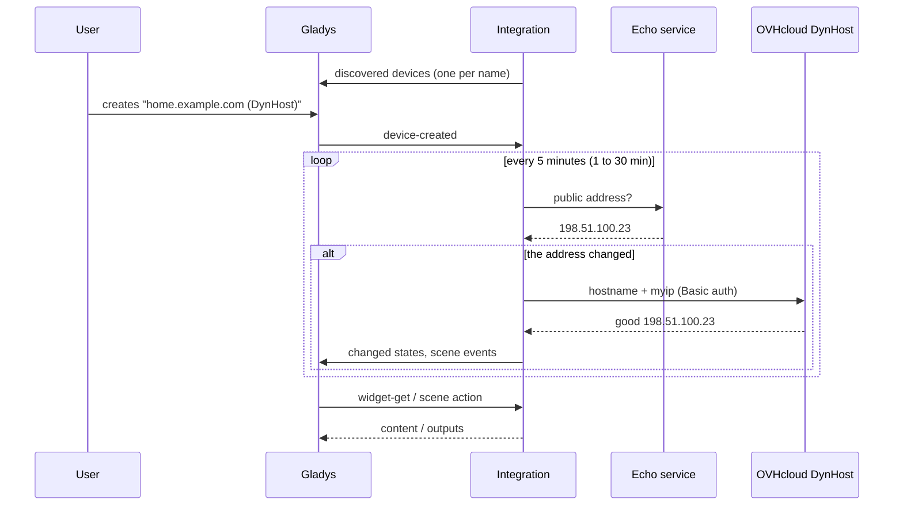

# Gladys OVHcloud DynHost

**English** · [Français](README.fr.md) · [Deutsch](README.de.md) · [Español](README.es.md)

[](LICENSE)
[](https://github.com/William-De71/gladys-ovhcloud-dynhost/releases)
[](https://github.com/William-De71/gladys-ovhcloud-dynhost/actions/workflows/release.yml)
[](https://gladysassistant.com)


[Gladys Assistant](https://gladysassistant.com) external integration for **dynamic DNS on an [OVHcloud](https://www.ovhcloud.com) domain**: Gladys keeps your DynHost names (`home.example.com`) pointed at the public IPv4 / IPv6 address of your home, through the official DynHost endpoint of OVHcloud. Each name becomes a device, and scenes can react when the public address changes or an update fails.

User documentation: [English](docs/en.md) · [Français](docs/fr.md) · [Deutsch](docs/de.md) · [Español](docs/es.md).

> Community integration, not affiliated with nor endorsed by OVHcloud.

## Features

- **Up to three DynHost names**, each following the IPv4 (A), the IPv6 (AAAA) or both; the 2nd and 3rd name can share the identifier of the 1st (an identifier created with the sub-domain `*`).
- **One device per name**: IPv4 and IPv6 addresses confirmed by OVHcloud, status in words, number of address changes.
- **3 scene triggers**: public address changed, record updated, update failed (once per error).
- **2 scene actions**: update now (one name or all, optionally forced), read the public address.
- **1 dashboard widget**: the public address and every record with its status, and an **Update now** button.
- **Configuration buttons**: test the connection (every record sent at once), diagnostic.
- Kind to OVHcloud: a record is only sent when it must change, never twice within a minute, and a refused update is not asked again before the settings or the address change (or 6 hours). Four languages (English, French, German, Spanish).



## How it works




At each check (every 5 minutes by default), the integration reads the public address on echo services (the next one when one fails) and compares it with the address OVHcloud last confirmed for each record, kept in `/data`. On the very first check, a name that already resolves to the public address is adopted without a call. Only a record that must change is sent to `https://dns.eu.ovhapis.com/nic/update` (`good` = changed, `nochg` = already right); a name changed by hand in the zone is put back a quarter of an hour later.



### Transport

Cloud only (`"transports": ["cloud"]`): the catalog shows the cloud badge, and there is no "prefer the local connection" button. The integration contacts the echo services `api.ipify.org`, `ipv4.icanhazip.com`, `v4.ident.me` (and their IPv6 twins when a name follows IPv6), which only see the address of your home, and `dns.eu.ovhapis.com` with your DynHost identifier. The passwords stay in Gladys and in the container; the **Diagnostic** button only shows their length.

## Devices and features

| Device             | Feature                    | Category / type            | Range          |
| ------------------ | -------------------------- | -------------------------- | -------------- |
| `<name>` (DynHost) | IPv4 address (A record)    | `text` / text              | —              |
| `<name>` (DynHost) | IPv6 address (AAAA record) | `text` / text              | —              |
| `<name>` (DynHost) | DynHost status             | `text` / text              | —              |
| `<name>` (DynHost) | Address changes            | `counter-sensor` / integer | 0 – 10 000 000 |

External id: `host:<name>` — the DynHost name in lowercase, whatever the slot it is typed in. The IPv4 / IPv6 features only exist when the name follows that family. `should_poll` is false: the integration checks on its own timer.

## Scene triggers, actions and widgets

| Kind    | Key                 | Use                                                                          |
| ------- | ------------------- | ---------------------------------------------------------------------------- |
| Trigger | `public_ip_changed` | The public address changed; filter: IPv4 / IPv6.                             |
| Trigger | `record_updated`    | OVHcloud pointed a name at a new address; filters: name device, IPv4 / IPv6. |
| Trigger | `update_failed`     | A record could not be updated, once per error; filters: name device, error.  |
| Action  | `update_now`        | Check and update now; one name or all, optionally forced.                    |
| Action  | `get_public_ip`     | The public IPv4 and IPv6, and a sentence.                                    |
| Widget  | `status`            | Public address, every record with its status, **Update now**.                |

The trigger variables give the name, the address type, the new and former addresses, and for a failure the error code and message. The first check is a baseline: the public address seen at install fires nothing, and a restart never fires the same change twice. A scene action never fires a trigger (no loops); a change it saw still fires at the next check.

Examples:

- "Public address changed" → send "New address: {{triggerEvent.data.ip}}" to your phone.
- "Update failed", error "identifier refused" → remind yourself to check the DynHost password.
- Every morning → "read the public address" → write it in a message.

## Requirements

- Gladys Assistant **5.3.0** or later (widgets, scene triggers and actions of external integrations, catalog keywords of Gladys 5.3). Older instances cannot install the integration.
- A domain at OVHcloud whose DNS zone is managed by OVHcloud, a **DynHost identifier** (Control Panel → domain → DynHost → Manage access) and a **DynHost record** per name (and a second one of type AAAA for IPv6).

## Installation

- **From the store** of Gladys (Integrations → External integrations), in one click, once indexed.
- **From the repository URL**: `https://github.com/William-De71/gladys-ovhcloud-dynhost`.
- **Developer mode**: build the image locally (`docker build -t gladys-ovhcloud-dynhost .`) and install it from Gladys.

## Configuration

| Field                       | Description                                                                      |
| --------------------------- | -------------------------------------------------------------------------------- |
| DynHost name (× 3)          | `home.example.com`, or `example.com` for the domain itself. The 1st is required. |
| DynHost identifier (× 3)    | `example.com-home`. Empty for the 2nd and 3rd name: the identifier of the 1st.   |
| Password (× 3)              | The password of the identifier (secret).                                         |
| Records to update (× 3)     | IPv4 (A, default), IPv6 (AAAA), or both.                                         |
| Check of the public address | Every minute, 5 minutes (default), 15 or 30 minutes.                             |
| Language of the texts       | Device names, status and scene summaries. Automatic follows the dashboard.       |

Buttons: **Test the connection** (sends every record to OVHcloud now and shows the answer per name) and **Diagnostic** (writes the settings, the public addresses, the confirmed records and the last errors to the Logs tab, passwords hidden).

## Usage

1. Create a DynHost identifier and a DynHost record in the OVHcloud Control Panel, enter the name, the identifier and its password, save and press **Test the connection**.
2. In the **Discover** tab, create the device of each name.
3. Add the **DynHost** widget to a dashboard, and build scenes with the triggers and actions above.

## Development

```bash
npm install
npm test                       # node --test, never touches the network
npm run lint && npm run format:check
npx github:GladysAssistant/integration-store . --skip-image-check
scripts/build-cover.sh         # cover.jpg from docs/assets/cover.svg
docs/illustrations/render.sh   # docs/assets/widgets.<lang>.png
node .github/scripts/release.mjs next
```

Locally, the SDK reads `GLADYS_HOST_API_URL`, `GLADYS_INTEGRATION_TOKEN` and `GLADYS_INTEGRATION_SELECTOR`; `DEBUG=gladys-integration-sdk` shows the SDK logs and checks every widget content. The tests use a fake network that answers like OVHcloud (`good`, `nochg`, dyndns2 codes, HTTP 401) and a fake resolver. The rules of the project are in [CLAUDE.md](CLAUDE.md).

## Release process


Every merge on `main` runs the CI, then computes the version from the [Conventional Commits](https://www.conventionalcommits.org/) since the last tag: `feat` → minor, `fix` / `perf` → patch, `!` or `BREAKING CHANGE` → major (a minor below 1.0.0); `docs`, `chore`, `ci`, `test`, `style`, `refactor`, `build` alone publish nothing. The changelog section is generated, the tag pushed, the multi-architecture image built, then `main` receives the release commit, the GitHub Release is created and a last job checks the public image, the store validator and the topic.

- The pull request title becomes the squash commit, then the changelog line: write it in English, for the user (`pr-title.yml` checks it). Never edit `CHANGELOG.md` by hand.
- 1.0.0 is a decision: Actions → Release → Run workflow with `release-as: 1.0.0`. `dry-run` shows the version and the notes without publishing.
- **Protected branch**: the release pushes its commit to `main` with `GITHUB_TOKEN`. With a ruleset on `main` stricter than "no deletion, no force-push", add GitHub Actions to its bypass list (or push through a GitHub App), otherwise the publish job fails with instructions.
- After the first release, make the `ghcr.io` package public (Package settings → Change visibility), or Gladys cannot pull it.

## Troubleshooting

See [docs/en.md](docs/en.md#troubleshooting). Report issues with the versions of Gladys and of the integration, the name and the address type concerned, and the lines of the **Diagnostic** button — never a password.

## Contributing

Issues and pull requests are welcome. Run `npm run format:check && npm run lint && npm test` before opening a pull request, and keep every external id and stored key unchanged (see [CLAUDE.md](CLAUDE.md)).

## Security

See [SECURITY.md](SECURITY.md): report vulnerabilities privately. The passwords are `secret` fields: never logged, never sent anywhere but to `dns.eu.ovhapis.com`, never written to `/data`. The integration runs read-only, as a non-root user, in its container.

## Screenshots to come

The images above are illustrations, not screenshots. Real screenshots will go in `docs/assets/screenshots/` (PNG, 1280 × 800): `configuration.png`, `discovery.png`, `device.png`, `scene.png`.

## License

[Apache License 2.0](LICENSE) — see also [NOTICE](NOTICE). The records are updated through the [DynHost endpoint of OVHcloud](https://docs.ovhcloud.com/fr/guides/web-cloud/domains/dns-dynhost); the public address is read on [ipify](https://www.ipify.org), [icanhazip](https://icanhazip.com) and [ident.me](https://ident.me). OVHcloud and DynHost are trademarks of OVH SAS. Thanks to the Gladys documentation and SDK.
